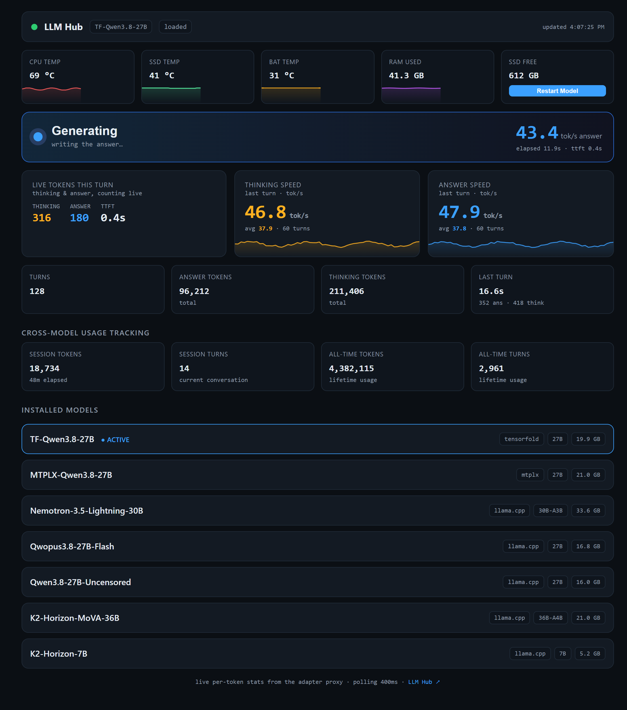

# LLM Hub

**One OpenAI-compatible endpoint for every local model on your Mac.** Point any client at
`http://<mac>:8090/v1`, pick a model by name, and the hub loads it on demand, unloading
whatever was running. Each model sits behind an adapter proxy that fixes the small
incompatibilities between engines (reasoning tags, `reasoning_effort` values, structured
output) and measures real prefill/decode speeds for a live dashboard.



<sub>Screenshot from `tools/demo_server.py`; all numbers are synthetic.</sub>

---

## Why

A 64 GB Apple-silicon machine can hold exactly one 27–36B model at a time, and the fastest
engine differs per model: speculative MLX engines for one, `llama.cpp` for the next. Agent
clients want a single provider with a model list. LLM Hub provides that:

- **One endpoint, many engines.** `llama.cpp`, mtplx, TensorFold, or any
  OpenAI-compatible server, behind one `/v1`.
- **Auto-swap.** Request a model that isn't loaded and the router stops the current engine,
  starts the requested one, waits until it's healthy, then streams your request.
- **Self-healing state.** The loaded model is whatever proxy reports its server `up`, so a
  manual switch, crash or router restart never leaves the hub confused.
- **Uniform reasoning.** Every engine's output arrives as `reasoning_content` + clean
  `content`, and `tool_calls` pass through untouched.
- **No more template 500s.** `reasoning_effort` is clamped to the values each chat template
  actually accepts, read live from the server.
- **Structured output that works.** `json_schema` requests are rewritten to GBNF grammars
  for `llama.cpp` builds that reject them.
- **Honest speed numbers.** Prefill and decode rates come from the engine's own `timings`,
  corrected for prompt-cache hits, and show live on the dashboard.
- **Zero dependencies.** Python 3 standard library only.

## How it fits together

```
 any OpenAI client ──► :8090  llm_router.py ──► :8091 proxy ──► :8081 llama-server   (model A)
 (Hermes, Open WebUI,        • /v1/models          :8095 proxy ──► :8088 mtplx serve     (model B)
  scripts, …)                • auto-swap           :8096 proxy ──► :8089 tensorfold      (model C)
                             • /sysinfo /stats     …            (only ONE server runs at a time)
 browser ──────────────────► :8090/  dashboard
```

| Component | File | Runs as |
|---|---|---|
| Router | `hub/llm_router.py` | always-on launchd agent, `:8090` |
| Adapter proxy | `hub/llm_proxy.py` | one always-on agent per model (loopback only) |
| Model switcher | `hub/llm_switch.py` | called by the router, or by you |
| Engine servers | your `llama-server` / `mtplx` / `tensorfold` command | on-demand launchd agents |
| Dashboard | `dashboard/index.html` | served by the router at `/` |
| Installer | `hub/install_launchd.py` | writes and loads the launchd plists |

Details: [docs/ARCHITECTURE.md](docs/ARCHITECTURE.md).

## Quick start (macOS)

Requirements: an Apple-silicon Mac (tested on M2 Max, 64 GB), the system `python3`, and
at least one engine installed (for example a Metal build of
[llama.cpp](https://github.com/ggml-org/llama.cpp)) plus model files.

```bash
git clone https://github.com/meisnick/llm-hub.git ~/llm-hub
cd ~/llm-hub

# 1. Describe your models (one entry per model; see docs/CONFIGURATION.md)
mkdir -p ~/.config/llmhub
cp config/hub.example.json ~/.config/llmhub/hub.json
$EDITOR ~/.config/llmhub/hub.json

# 2. Write + load the launchd agents (router, proxies; servers stay on-demand)
python3 hub/install_launchd.py

# 3. Load a model and smoke-test it end to end
python3 hub/llm_switch.py <model-key>
python3 tools/check_hub.py --hub http://localhost:8090 --model <model-id>
```

Open `http://<mac>:8090/` for the dashboard and point clients at `http://<mac>:8090/v1`
(any API key works). Client setup, including Hermes Agent: [docs/CLIENTS.md](docs/CLIENTS.md).

**Try the dashboard without any models:** `python3 tools/demo_server.py`, then open
`http://localhost:8090/?demo`.

## Supported engines

| `engine` | Server | Reasoning | Structured output | Notes |
|---|---|---|---|---|
| `llama.cpp` | `llama-server` | think tags split by the proxy (`--reasoning-format none`) | `json_schema` → GBNF rewrite | the default for GGUF models |
| `mtplx` | `mtplx serve` | pre-split by the engine | native (needs `llguidance`) | multi-token-prediction speculative decode; needs `--no-auth` |
| `tensorfold` | `tensorfold serve` | pre-split by the engine | native (needs `tensorfold[grammar]`) | speculative drafts; reports acceptance stats |
| `openai` | anything OpenAI-compatible | auto-detected | passed through | generic fallback |

Per-engine flags, quirks and measured speeds: [docs/ENGINES.md](docs/ENGINES.md).

## Reference performance

M2 Max, 64 GB, single user. Decode speeds are each engine's own `timings`:

| Model | Engine | Quant | Context | Decode tok/s |
|---|---|---|---|---|
| Nemotron-3.5-Lightning-30B-A3B | llama.cpp | Q8_0 | 128K | ~65 |
| K2-Horizon-7B | llama.cpp | Q4_K_M | 256K | ~57 |
| TF-Qwen3.8-27B | TensorFold (DFlash2 drafter) | MLX 4-bit | 64K | ~36–60 |
| K2-Horizon-MoVA-36B-A4B | llama.cpp | Q4_K_M | 128K | ~49 |
| MTPLX-Qwen3.8-27B | mtplx (MTP) | FP16 | 256K | ~30–40 |
| Qwen3.8-27B / Qwopus3.8-27B | llama.cpp | Q4_K_M | 128K | ~17 |

Speculative engines (mtplx, TensorFold) are about 2× faster than plain llama.cpp on the
same 27B weights for predictable prose; the gap shrinks on code and unpredictable output.

## Documentation

| Doc | What's in it |
|---|---|
| [ARCHITECTURE.md](docs/ARCHITECTURE.md) | request flow, auto-swap, self-healing, the proxy pipeline, HTTP API |
| [CONFIGURATION.md](docs/CONFIGURATION.md) | every `hub.json` key, placeholders, adding a model |
| [ENGINES.md](docs/ENGINES.md) | llama.cpp / mtplx / TensorFold flags, quirks, memory sizing |
| [STATS.md](docs/STATS.md) | how prefill/decode/think/answer speeds and token counters are computed |
| [CLIENTS.md](docs/CLIENTS.md) | Hermes Agent, Open WebUI, curl, Python; reasoning and structured output |
| [OPERATIONS.md](docs/OPERATIONS.md) | switching, logs, restarts, upgrades, the Metal wired-memory limit |
| [TROUBLESHOOTING.md](docs/TROUBLESHOOTING.md) | the failure modes we actually hit, and their fixes |

## Security

The router listens on all interfaces by default and has **no authentication**. Anyone who
can reach the port can run prompts and switch models. Keep it on a trusted LAN or VPN, or set
`"listen_host": "127.0.0.1"` and front it with your own reverse proxy. Proxies and engine
servers bind to loopback in the example config. The proxy never logs prompt text unless you
set `LLMHUB_DUMP_BODY=1`.

## Tests

```bash
python3 -m unittest discover -s tests          # pure-logic unit tests (no models needed)
python3 tools/check_hub.py --hub http://localhost:8090 --model <id>   # live end-to-end
```

## License

MIT. See [LICENSE](LICENSE). Model weights and engines have their own licenses.
